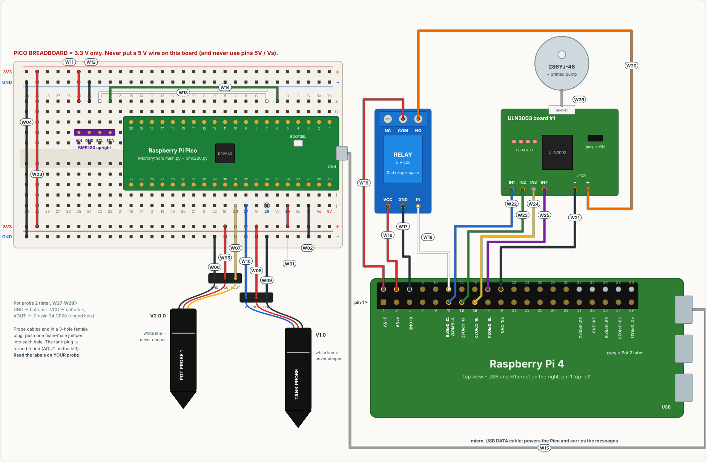

# PlantPi

Automatic plant monitoring and watering. Group 19, Embedded Linux (EMLI), SDU.

A **Raspberry Pi 4** running Linux is the controller. It logs everything to SQLite, decides when
to water, and drives a **3D-printed peristaltic pump** on a **28BYJ-48 stepper motor**.
A **Raspberry Pi Pico sensor node** (MicroPython) measures the soil probes, the tank level and the air,
and sends the readings to the Pi as JSON lines over a USB cable.

```
 soil probe(s) ─┐                                  ┌─ relay ── 5 V ── ULN2003 ── 28BYJ-48 ── peristaltic pump
 tank probe   ──┼─ Pico node ─── USB serial ──► Raspberry Pi 4 (systemd service, SQLite log)
 BME280 (opt.) ─┘   measures only      JSON lines   decides + logs                 (GPIO 17/27/22/24, relay GPIO18)
```

**Wiring drawing, soldering and limitations:** [`docs/PlantPi_wiring.pdf`](docs/PlantPi_wiring.pdf).
The same table is printed by `plantpi pins`.



How the pump moves water (animated): open `docs/pump.html` in a browser.

## Why a separate sensor node? (distributed system)

The Pi has no analog inputs, so a separate microcontroller does the measuring. It runs its own
firmware and only *reports*; the Pi only *decides*. The two talk by messages, so this is a small
distributed system even though the link is a cable:

* **More sensors:** add one line to `SENSORS` in `main.py` on the Pico, give the sensor a name, and use
  that name in `config.toml`. The Pi code does not change. (The Pico has 3 analog pins: GP26, GP27, GP28.)
* **More nodes / Wi-Fi later:** the messages are plain JSON lines. Sending the same lines over
  Wi-Fi (MQTT or TCP) only replaces the transport class (`plantpi/node.py`), not the logic.
* **Fail-safe:** if the node goes silent for 10 s (cable pulled, crash), the Pi stops any running
  pump and does not water until fresh data arrives.

We use the **cable** because it also powers the Pico, needs no Wi-Fi setup at the university, and
keeps working when the network is down. The Pico from the kit is used because it has 3 analog inputs
(0–3.3 V); the Feather HUZZAH ESP8266 has only one (0–1 V). The HUZZAH stays free for a Wi-Fi node
later (Block 2), which would send the same JSON lines.

## Repository layout

```
plantpi/                    Python package that runs on the Pi
  __main__.py               command line (plantpi run | status | water | calibrate | test | pins)
  controller.py             read -> decide -> water -> log, all safety rules
  node.py                   sensor-node message format + USB serial client
  hardware.py               stepper pump (ULN2003) + relay via gpiozero
  sim.py                    simulated hardware: run everything on a laptop
  store.py                  SQLite log
  commission.py             hardware checks, one per wiring step
  config.py                 config + calibration
firmware/pico_sensor_node/  MicroPython for the Pico: main.py + bmx280.py (air sensor)
deploy/                     setup.sh, plantpi.service, watchdog.conf
docs/                       wiring drawing (PDF), pump animation (pump.html)
cad/                        Fusion script for the 3D-printed pump
tests/                      pytest
config.example.toml         one pot now, Pot 2 ready to uncomment
```

## 1. Try it on a laptop (no hardware)

Needs Python 3.11 or newer.

```bash
python3 -m plantpi run --sim                 # simulated pot + tank + node, 60x speed, Ctrl+C to stop
python3 -m plantpi status --sim
python3 -m plantpi water 1 15 --sim          # ask for 15 ml ...
python3 -m plantpi run --sim --cycles 1      # ... and watch the service pump it
python3 -m plantpi pins                      # the wiring table

pip install pytest pyserial && python3 -m pytest -q          # 46 tests, incl. the Pico firmware
```

## 2. Put the program on the Pico

Leave the Pico on its breadboard (kit rule).

1. Download the **MicroPython .uf2 for Raspberry Pi Pico** from micropython.org (the plain *Pico*,
   not *Pico W*).
2. Hold the **BOOTSEL** button, plug the Pico into a laptop, release. A drive called **RPI-RP2**
   appears: drag the .uf2 file onto it. The Pico restarts with MicroPython.
3. Install **Thonny** (thonny.org). Bottom-right corner: choose *MicroPython (Raspberry Pi Pico)*.
4. Open `firmware/pico_sensor_node/bmx280.py` → *File → Save as… → Raspberry Pi Pico* → `bmx280.py`.
   Do the same with `main.py` (the name must be exactly `main.py`, so it starts by itself).
5. Press the reset (or unplug/replug). Thonny's Shell prints a line every 2 s starting with `{"v":1`.
   Close Thonny before plugging the Pico into the Raspberry Pi (only one program can use the port).

## 3. Install on the Raspberry Pi

1. Flash **Raspberry Pi OS Lite (64-bit)** with Raspberry Pi Imager. In its settings set hostname
   `plantpi`, a user and password, your Wi-Fi, and enable SSH.
2. Copy this folder to the Pi and install (no reboot needed):

```bash
scp -r plantpi <user>@plantpi.local:~/
ssh <user>@plantpi.local
cd ~/plantpi && sudo ./deploy/setup.sh
```

## 4. Wire, test, calibrate (follow the drawing; one check per step)

| Step | Wire | Check | Expected |
|---|---|---|---|
| 1 | probes + BME280 on the Pico breadboard (W01–W14) | Thonny Shell on a laptop | numbers change when you touch a probe |
| 2 | Pico USB → Pi (W15) | `plantpi test node` | all sensors PASS |
| 3 | relay (W16–W19) | `plantpi test relay 1` | two clicks, LED on only during the test |
| 4 | ULN2003 + motor (W20–W26) | `plantpi test motor 1` | shaft turns one way, then back |
| 5 | pump assembled, tubes in tank and cup | `plantpi test pump 1` | prints `ml_per_rev`: copy it into the config |
| 6 | probes in place | `plantpi calibrate 1`, `plantpi calibrate tank` | dry and wet values saved |
| 7 | — | `sudo systemctl enable --now plantpi` | `journalctl -u plantpi -f` shows samples |

The tests and calibration need the service stopped: `sudo systemctl stop plantpi`.

## 5. Commands

| Command | What it does |
|---|---|
| `plantpi status` | last samples and events |
| `plantpi water 1 30` | ask the running service to pump about 30 ml into pot 1 |
| `plantpi calibrate 1` / `2` / `tank` | record the dry and wet values for a probe |
| `plantpi test node` / `relay 1` / `motor 1` / `pump 1` | hardware checks |
| `plantpi pins` | wiring table |
| `journalctl -u plantpi -f` | live log |

Files on the Pi: `/etc/plantpi/config.toml` (settings), `/var/lib/plantpi/calibration.json`,
`/var/lib/plantpi/plantpi.db` (tables `samples`, `soil`, `events`, `requests`), program in `/opt/plantpi`.

## 6. Safety rules in the code

* A pot is watered only if its probe says **dry**, the **tank level ≥ 15 %**, the **node data is fresh**,
  and its **cooldown** (60 min) and **daily limit** (4 doses) allow it. Doses are remembered across restarts.
* **One pump at a time.** Each run is capped at **20 min** and **250 ml**.
* A run **stops early** if the tank drops below 10 %, the node goes silent, or the service stops.
* The **relay cuts the 5 V** to the motor drivers whenever no pump runs, and the motor coils are
  switched off after every run (no heat, no current at boot).
* Unpowered, shorted or uncalibrated probes mean **no watering**, and the problem is logged as a fault.
* No automatic watering for 10 min after start (protects against a crash loop).
* A systemd **watchdog** restarts a hung program; the **hardware watchdog** reboots a frozen Pi.
* Timers use the **monotonic clock**, because the Pi 4 has no real-time clock.

## 7. Adding Pot 2

You need a second 28BYJ-48 and ULN2003 board; probe 2 is already in the kit. Wire W27–W36 and
remove the `# ` in front of the Pot 2 block in `/etc/plantpi/config.toml`. Then run
`plantpi test motor 2`, `plantpi test pump 2` and `plantpi calibrate 2`, and restart the service.
One relay powers both motor drivers, so the second relay module is a spare.
